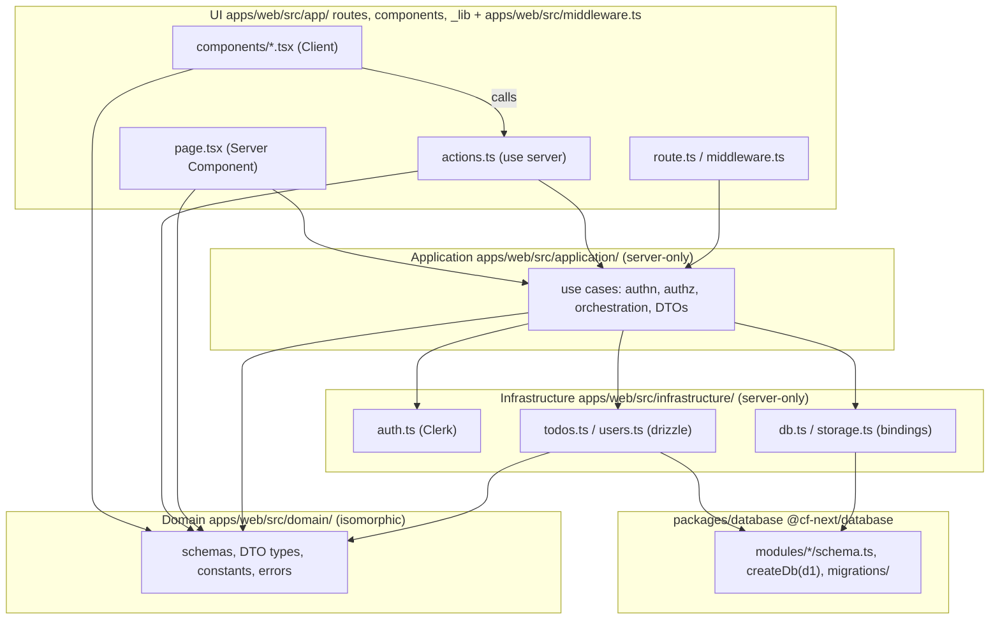
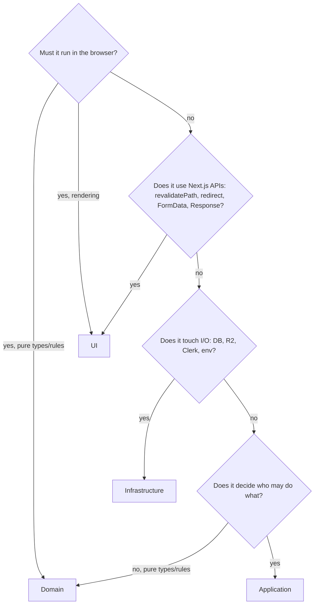

# Architecture

This document describes the **current rules** for structuring application code under `src/`.
It is declarative: it says what the structure is and what is allowed, not how it was decided.
Decision history lives in [`docs/adr/`](docs/adr/).

> **Status:** layers adopted by [ADR-0001](docs/adr/0001-layered-app-structure.md); one directory
> per layer under `src/` by [ADR-0002](docs/adr/0002-src-layer-directories.md); table definitions
> and migrations in `packages/database` by [ADR-0003](docs/adr/0003-database-package.md); the Next.js
> app (and its `src/`) moved into `apps/web/`, managed by Nx, by
> [ADR-0004](docs/adr/0004-apps-web-nx-layout.md). All fully
> applied (see [Migration status](#migration-status)). All code must follow this document.

## Layers

Four layers, named after Evans' *Domain-Driven Design* layered architecture. The Application layer
is what the Next.js docs call the Data Access Layer (DAL).

| Layer | Directory | Responsibility | Runs on |
|---|---|---|---|
| UI | `apps/web/src/app/` (routes, `components/`, `_lib/`), `apps/web/src/middleware.ts` | Everything bound to a URL or to Next.js APIs: pages, layouts, Client Components, Server Actions, Route Handlers, `revalidatePath`, `redirect`, turning domain errors into HTTP/UI results | server + client |
| Application | `apps/web/src/application/` | One use case = one exported function. Authenticates and authorizes first, orchestrates Infrastructure, returns DTOs. Knows nothing about Next.js | server only |
| Domain | `apps/web/src/domain/` | Pure types, zod schemas, constants, rules and error classes. No I/O, no framework imports | server + client |
| Infrastructure | `apps/web/src/infrastructure/` | Cloudflare bindings (D1, R2), Clerk SDK, drizzle queries, `process.env`. Converts DB rows into Domain DTOs before returning. Table definitions and migrations come from `packages/database` (`@cf-next/database`), which only this layer may import | server only |

`apps/web/src/application/` and `apps/web/src/infrastructure/` modules start with `import "server-only"`.
`apps/web/src/app/` is the App Router directory; inside it, folders prefixed with `_` (such as `_lib/`) are
excluded from routing. `apps/web/src/middleware.ts` is UI but must sit next to `apps/web/src/app/`, not inside it:
Next.js only loads it from that level.

## Dependency rule

Dependencies point downward only. Domain depends on nothing.

| from \ to | `domain` | `application` | `infrastructure` | `@cf-next/database`, `drizzle-orm`, `@clerk/nextjs/server`, `@opennextjs/cloudflare` | `next/cache`, `next/navigation` | React client APIs |
|---|---|---|---|---|---|---|
| UI | yes | yes (server files only) | **no** | **no** | yes | yes |
| `application` | yes | yes | yes | **no** | **no** | **no** |
| `infrastructure` | yes | **no** | yes | yes | **no** | **no** |
| `domain` | yes | **no** | **no** | **no** | **no** | **no** |
| `packages/database` | **no** | **no** | **no** | `drizzle-orm` only | **no** | **no** |

Exception: `apps/web/src/middleware.ts` imports `@clerk/nextjs/server` for `clerkMiddleware`, so it is not covered by the UI lint block.

Enforcement: per-layer `no-restricted-imports` rules in `eslint.config.mjs` (one block per layer
directory), the Nx `depConstraints` for the `type:database` and `type:ui` projects, and the cases
in `__tests__/module-boundaries.test.ts`. The lint config is the source of
truth; this table is a summary. `src/application/` and `src/infrastructure/` modules cannot be
imported from Client Components because they start with `import "server-only"`.

## Public entry points

Only the UI layer is reachable from outside. Treat each of these as an untrusted entry point;
authentication and authorization still happen inside the Application layer.

| Entry point | Reachable via | Rule |
|---|---|---|
| `page.tsx`, `layout.tsx` | GET | Server Components call Application functions directly. They never go through a Server Action for reads |
| `actions.ts` (`"use server"`) | POST from any page (an action is a POST against the page that invokes it) | Export **mutations only**. Keep them thin: parse input, call one Application function, `revalidatePath`, map errors |
| `route.ts` | any HTTP method | Call Application, map errors to status codes |
| `apps/web/src/middleware.ts` | every matched request | Optimistic redirect to `/sign-in` only. No authorization decisions here; path matching cannot protect Server Actions |

## Code map

Directories only; file lists go stale.

| Path | Layer | Contents |
|---|---|---|
| `apps/web/src/app/<route>/page.tsx`, `layout.tsx`, `loading.tsx` | UI | Route files |
| `apps/web/src/app/<route>/actions.ts` | UI | Server Actions for that route |
| `apps/web/src/app/<route>/components/` | UI | Client Components used by that route (a folder without `page.tsx` is not a route, so no `_` prefix is needed) |
| `apps/web/src/app/components/` | UI | Components shared across routes (navigation, footer, analytics) |
| `apps/web/src/app/_lib/` | UI | UI-side helpers, e.g. `runAction` that maps domain errors to `ActionResult` |
| `apps/web/src/middleware.ts` | UI | Clerk sign-in redirect; location fixed by Next.js |
| `apps/web/src/application/<feature>.ts` | Application | Use cases for one feature |
| `apps/web/src/domain/<feature>.ts`, `errors.ts` | Domain | Schemas, DTO types, constants, error classes |
| `apps/web/src/infrastructure/db.ts` | Infrastructure | `getDb()`: looks up the D1 binding through OpenNext and memoizes `createDb()` per request with `cache()` |
| `apps/web/src/infrastructure/auth.ts` | Infrastructure | `getCurrentUserId()`, `isAdmin()`; the only reader of `ADMIN_EMAILS` |
| `apps/web/src/infrastructure/storage.ts` | Infrastructure | R2 bucket access |
| `apps/web/src/infrastructure/<feature>.ts` | Infrastructure | Queries for one feature; returns Domain DTOs, never raw rows |
| `<module>.test.ts` next to its module | same as the module | Unit tests for that module; the module's layer rules apply. Cross-cutting tests live in `__tests__/` |
| `packages/database/src/modules/<name>/schema.ts` | (outside; imported by Infrastructure only) | Table definitions for one module. Register each module in `packages/database/src/schema.ts` |
| `packages/database/src/db.ts` | (outside) | `createDb(d1)`: opens the database from a D1 binding without OpenNext, for any Worker |
| `packages/database/migrations/` | (outside) | drizzle-kit output (`pnpm run db:generate`); `wrangler.jsonc` `migrations_dir` points here. `packages/database/test/migrations.test.ts` fails when schema and migrations drift |
| `packages/ui/` | (outside) | Presentation-only components; may not import app code (Nx boundary) |

## Where does new code go?

## Data crossing layer boundaries

- Infrastructure converts DB rows to Domain DTOs (`toTodo(row)`). Rows, including `userId`, never leave Infrastructure.
- A DTO is shaped for an audience. If an admin view needs owner information, add a separate DTO (e.g. `TodoWithOwner`) assembled in Application instead of widening `Todo`.
- Server Actions return only what the UI needs (`ActionResult<T>`), never raw records.

## Errors across layers

Application throws Domain error classes. The UI layer converts them at the entry point.

| Error | `page.tsx` | `actions.ts` | `route.ts` |
|---|---|---|---|
| `UnauthorizedError` | `redirect("/sign-in")` | `{ ok: false, error }` | 401 |
| `ForbiddenError` | `redirect("/")` | `{ ok: false, error }` | 403 |
| `NotFoundError` | `notFound()` | `{ ok: false, error }` | 404 |
| `ValidationError` | n/a | `{ ok: false, error }` | 400 |
| anything else | rethrow → `error.tsx` | rethrow | 500 |

`unauthorized()` / `forbidden()` from Next.js are not used; they require the experimental `authInterrupts` flag.

## Deliberate deviations from textbook layering

| Rule | Why |
|---|---|
| Server Components call Application directly instead of going through a Server Action | Every exported `"use server"` function that the app references is a POST endpoint anyone can call (unused ones are stripped at build time, but treat all of them as untrusted input). Reads do not need one |
| Domain is isomorphic (no `server-only`) | zod schemas and limits such as `MAX_IMAGE_SIZE` are shared between client-side instant validation and server-side final validation, so they are written once |
| Application imports Infrastructure directly; no repository interfaces or DI | Two features do not justify ports. Unit-test Application with `vi.mock("@/infrastructure/...")`. Introduce interfaces only when a second implementation actually exists |
| `revalidatePath` / `redirect` live in the UI layer, not in Application | Which URL goes stale is a presentation concern. Application stays callable from cron routes, tests and future APIs without changes |
| `apps/web/src/middleware.ts` only redirects unauthenticated users; admin checks live in Application | Middleware matches on path, but actions are POSTed to whichever page invoked them, so path-based rules cannot enforce authorization |
| `apps/web/src/middleware.ts` keeps its name instead of the Next 16 `proxy.ts` convention | `proxy.ts` runs on the Node.js runtime, which the OpenNext Cloudflare adapter does not support (see README). Revisit when the adapter does |
| Table definitions live in `packages/database`, not in `apps/web/src/infrastructure/` | Any Worker on the same D1 (cron, queue, scripts) needs the schema and migrations without Next.js. Queries stay in Infrastructure because they return Domain DTOs ([ADR-0003](docs/adr/0003-database-package.md)) |
| `apps/web` and `packages/*` are plain pnpm workspace directories, not separate build systems | Nx (`nx.json`, per-package `"nx"` field) only adds the project graph, target running (`nx dev web`, `nx build web`) and dependency-boundary lint; the layer rules above are unaffected ([ADR-0004](docs/adr/0004-apps-web-nx-layout.md)) |

## Non-goals

- Layers are not separate Nx projects or packages; `packages/database` holds table definitions and migrations, not a layer. Revisit the rest when a second app shares them.
- No abstraction over D1/R2/Clerk beyond the Infrastructure modules. Swapping providers is not a design goal.
- `unauthorized()` / `forbidden()` (experimental) are not adopted.

## Migration status

Tracked in [ADR-0001](docs/adr/0001-layered-app-structure.md). Completed; `lib/` and
`app/actions/` no longer exist. Paths in this list are as of ADR-0001; the layers then moved to
`src/<layer>/` in one step ([ADR-0002](docs/adr/0002-src-layer-directories.md)).

- [x] 1. Create `app/_domain/` and `app/_infrastructure/` (mostly moves from `lib/`); update `drizzle.config.ts`
- [x] 2. Move read functions into `app/_application/`; call them from Server Components (no actions for reads)
- [x] 3. Thin out mutation actions; add `app/_lib/action-result.ts`
- [x] 4. Drop the admin check from `middleware.ts` (the rename to `proxy.ts` is deferred; see the ADR amendments)
- [x] 5. Add per-layer `no-restricted-imports` rules and boundary tests
- [x] 6. Route `/api/images/[...key]` through Application with an ownership check

[ADR-0003](docs/adr/0003-database-package.md): completed in one step; `src/infrastructure/schema.ts`,
`drizzle.config.ts` and `drizzle/` at the root no longer exist.

[ADR-0004](docs/adr/0004-apps-web-nx-layout.md): completed in one step; the Next.js app and its
`src/` moved to `apps/web/`, `pnpm-workspace.yaml` adds `apps/*`, and `nx dev web` / `nx build web`
replace the root-level `next dev` / `next build` scripts.

## References

- Next.js 16 docs (bundled in `node_modules/next/dist/docs/`): `01-app/02-guides/data-security.md` (Data Access Layer, `server-only`, Server Actions reachability), `01-app/02-guides/server-actions.md` (actions are POSTs against the invoking page), `01-app/01-getting-started/02-project-structure.md` (private folders, project files outside of `app`), `01-app/03-api-reference/03-file-conventions/src-folder.md` (`src/app`, `@/*` paths), `01-app/03-api-reference/03-file-conventions/proxy.md` (Middleware/Proxy location)
- Eric Evans, *DDD Reference* (2015), "Layered Architecture": https://www.domainlanguage.com/ddd/reference/
- Martin Fowler, "Presentation Domain Data Layering": https://martinfowler.com/bliki/PresentationDomainDataLayering.html
- Robert C. Martin, "The Clean Architecture" (2012): https://blog.cleancoder.com/uncle-bob/2012/08/13/the-clean-architecture.html
