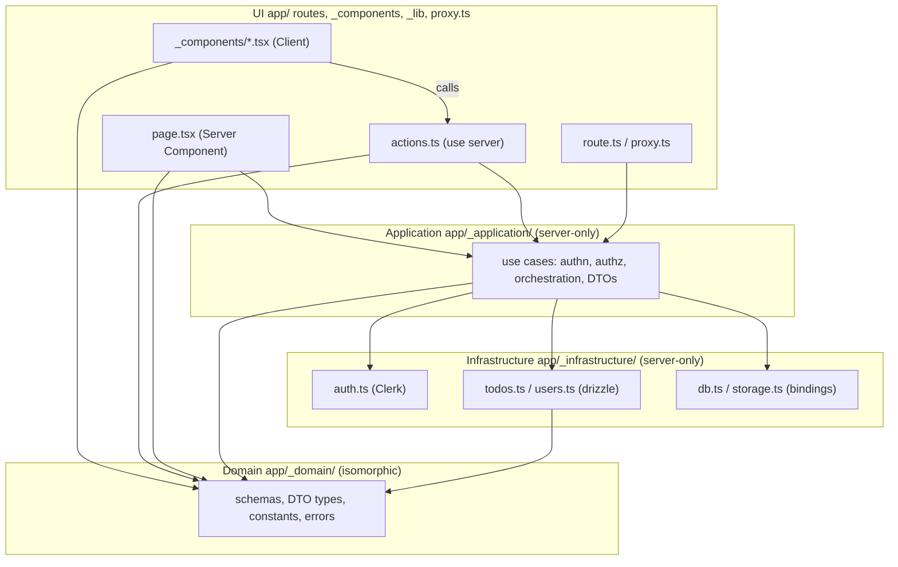
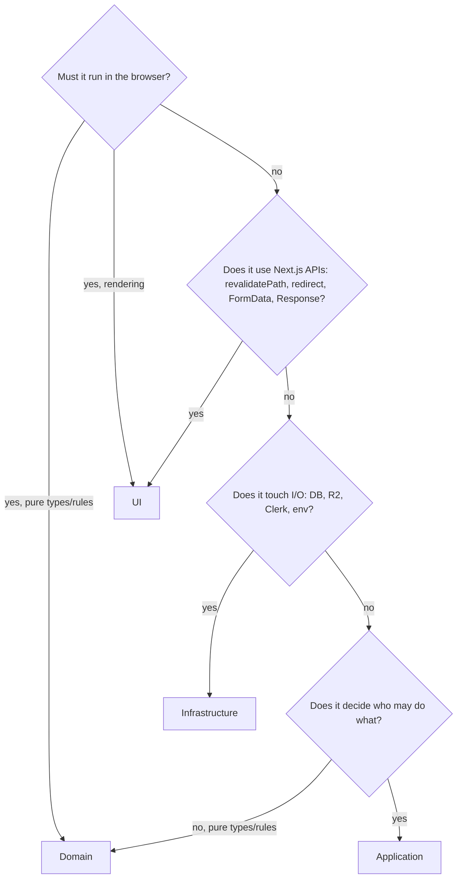

# Architecture

This document describes the **current rules** for structuring application code under `app/`.
It is declarative: it says what the structure is and what is allowed, not how it was decided.
Decision history lives in [`docs/adr/`](docs/adr/).

> **Status:** target structure adopted by [ADR-0001](docs/adr/0001-layered-app-structure.md).
> Existing code is still being migrated (see [Migration status](#migration-status)).
> New code must follow this document; do not add to `lib/` or `app/actions/`.

## Layers

Four layers, named after Evans' *Domain-Driven Design* layered architecture. The Application layer
is what the Next.js docs call the Data Access Layer (DAL).

| Layer | Directory | Responsibility | Runs on |
|---|---|---|---|
| UI | `app/` (routes, `_components/`, `_lib/`), `proxy.ts` | Everything bound to a URL or to Next.js APIs: pages, layouts, Client Components, Server Actions, Route Handlers, `revalidatePath`, `redirect`, turning domain errors into HTTP/UI results | server + client |
| Application | `app/_application/` | One use case = one exported function. Authenticates and authorizes first, orchestrates Infrastructure, returns DTOs. Knows nothing about Next.js | server only |
| Domain | `app/_domain/` | Pure types, zod schemas, constants, rules and error classes. No I/O, no framework imports | server + client |
| Infrastructure | `app/_infrastructure/` | Cloudflare bindings (D1, R2), Clerk SDK, drizzle queries, `process.env`. Converts DB rows into Domain DTOs before returning | server only |

`app/_application/` and `app/_infrastructure/` modules start with `import "server-only"`.
Folders prefixed with `_` are excluded from routing by Next.js.

## Dependency rule

Dependencies point downward only. Domain depends on nothing.

| from \ to | `_domain` | `_application` | `_infrastructure` | `drizzle-orm`, `@clerk/nextjs/server`, `@opennextjs/cloudflare` | `next/cache`, `next/navigation` | React client APIs |
|---|---|---|---|---|---|---|
| UI | yes | yes (server files only) | **no** | **no** | yes | yes |
| `_application` | yes | yes | yes | **no** | **no** | **no** |
| `_infrastructure` | yes | **no** | yes | yes | **no** | **no** |
| `_domain` | yes | **no** | **no** | **no** | **no** | **no** |

Exception: `proxy.ts` may import `@clerk/nextjs/server` for `clerkMiddleware`.

Enforcement: per-layer `no-restricted-imports` rules in `eslint.config.mjs` and cases in
`__tests__/module-boundaries.test.ts` are migration step 5 and **do not exist yet**. Today the only
lint-enforced boundary is the Nx rule between the app and `packages/ui`. Until step 5 lands, this
table is the source of truth; once it lands, the lint config is, and this table becomes a summary.

## Public entry points

Only the UI layer is reachable from outside. Treat each of these as an untrusted entry point;
authentication and authorization still happen inside the Application layer.

| Entry point | Reachable via | Rule |
|---|---|---|
| `page.tsx`, `layout.tsx` | GET | Server Components call Application functions directly. They never go through a Server Action for reads |
| `actions.ts` (`"use server"`) | POST from any page (an action is a POST against the page that invokes it) | Export **mutations only**. Keep them thin: parse input, call one Application function, `revalidatePath`, map errors |
| `route.ts` | any HTTP method | Call Application, map errors to status codes |
| `proxy.ts` | every matched request | Optimistic redirect to `/sign-in` only. No authorization decisions here; path matching cannot protect Server Actions |

## Code map

Directories only; file lists go stale.

| Path | Layer | Contents |
|---|---|---|
| `app/<route>/page.tsx`, `layout.tsx`, `loading.tsx` | UI | Route files |
| `app/<route>/actions.ts` | UI | Server Actions for that route |
| `app/<route>/_components/` | UI | Client Components used by that route |
| `app/_components/` | UI | Components shared across routes (navigation, footer, analytics) |
| `app/_lib/` | UI | UI-side helpers, e.g. `runAction` that maps domain errors to `ActionResult` |
| `app/_application/<feature>.ts` | Application | Use cases for one feature |
| `app/_domain/<feature>.ts`, `errors.ts` | Domain | Schemas, DTO types, constants, error classes |
| `app/_infrastructure/db.ts`, `schema.ts` | Infrastructure | Drizzle client (memoized with `cache()`) and table definitions |
| `app/_infrastructure/auth.ts` | Infrastructure | `getCurrentUserId()`, `isAdmin()`; the only reader of `ADMIN_EMAILS` |
| `app/_infrastructure/storage.ts` | Infrastructure | R2 bucket access |
| `app/_infrastructure/<feature>.ts` | Infrastructure | Queries for one feature; returns Domain DTOs, never raw rows |
| `packages/ui/` | (outside) | Presentation-only components; may not import app code (Nx boundary) |

## Where does new code go?

## Data crossing layer boundaries

- Infrastructure converts DB rows to Domain DTOs (`toTodo(row)`). Rows, including `userId`, never leave Infrastructure.
- A DTO is shaped for an audience. If an admin view needs owner information, add a separate DTO (e.g. `TodoWithOwner`) assembled in Application instead of widening `Todo`.
- Server Actions return only what the UI needs (`ActionResult<T>`), never raw records.

## Errors across layers

Application throws Domain error classes. The UI layer converts them at the entry point.

| Error | `page.tsx` | `actions.ts` | `route.ts` |
|---|---|---|---|
| `UnauthorizedError` | `redirect("/sign-in")` | `{ ok: false, error }` | 401 |
| `ForbiddenError` | `redirect("/")` | `{ ok: false, error }` | 403 |
| `NotFoundError` | `notFound()` | `{ ok: false, error }` | 404 |
| `ValidationError` | n/a | `{ ok: false, error }` | 400 |
| anything else | rethrow → `error.tsx` | rethrow | 500 |

`unauthorized()` / `forbidden()` from Next.js are not used; they require the experimental `authInterrupts` flag.

## Deliberate deviations from textbook layering

| Rule | Why |
|---|---|
| Server Components call Application directly instead of going through a Server Action | Every exported `"use server"` function that the app references is a POST endpoint anyone can call (unused ones are stripped at build time, but treat all of them as untrusted input). Reads do not need one |
| Domain is isomorphic (no `server-only`) | zod schemas and limits such as `MAX_IMAGE_SIZE` are shared between client-side instant validation and server-side final validation, so they are written once |
| Application imports Infrastructure directly; no repository interfaces or DI | Two features do not justify ports. Unit-test Application with `vi.mock("@/app/_infrastructure/...")`. Introduce interfaces only when a second implementation actually exists |
| `revalidatePath` / `redirect` live in the UI layer, not in Application | Which URL goes stale is a presentation concern. Application stays callable from cron routes, tests and future APIs without changes |
| `proxy.ts` only redirects unauthenticated users; admin checks live in Application | Proxy matches on path, but actions are POSTed to whichever page invoked them, so path-based rules cannot enforce authorization |

## Non-goals

- Layers are not separate Nx projects or packages. Revisit when a second app shares them.
- No abstraction over D1/R2/Clerk beyond the Infrastructure modules. Swapping providers is not a design goal.
- `unauthorized()` / `forbidden()` (experimental) are not adopted.

## Migration status

Tracked in [ADR-0001](docs/adr/0001-layered-app-structure.md). Until all steps are done, `lib/` and
`app/actions/` still exist; treat them as legacy and move code out rather than adding to them.

- [ ] 1. Create `app/_domain/` and `app/_infrastructure/` (mostly moves from `lib/`); update `drizzle.config.ts`
- [ ] 2. Move read functions into `app/_application/`; call them from Server Components (no actions for reads)
- [ ] 3. Thin out mutation actions; add `app/_lib/action-result.ts`
- [ ] 4. Rename `middleware.ts` to `proxy.ts`; drop the admin check from it
- [ ] 5. Add per-layer `no-restricted-imports` rules and boundary tests
- [ ] 6. Route `/api/images/[...key]` through Application with an ownership check

## References

- Next.js 16 docs (bundled in `node_modules/next/dist/docs/`): `01-app/02-guides/data-security.md` (Data Access Layer, `server-only`, Server Actions reachability), `01-app/02-guides/server-actions.md` (actions are POSTs against the invoking page), `01-app/01-getting-started/02-project-structure.md` (private folders)
- Eric Evans, *DDD Reference* (2015), "Layered Architecture": https://www.domainlanguage.com/ddd/reference/
- Martin Fowler, "Presentation Domain Data Layering": https://martinfowler.com/bliki/PresentationDomainDataLayering.html
- Robert C. Martin, "The Clean Architecture" (2012): https://blog.cleancoder.com/uncle-bob/2012/08/13/the-clean-architecture.html
